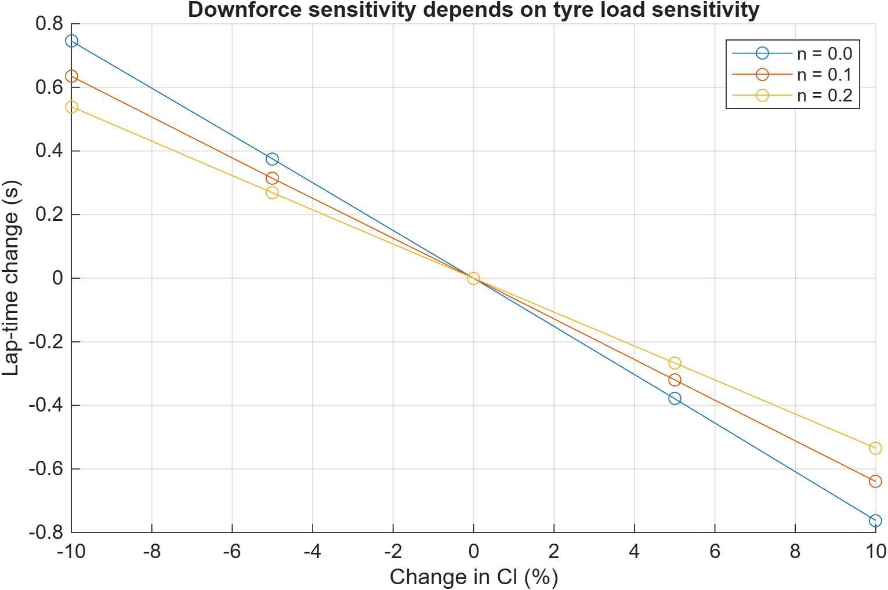
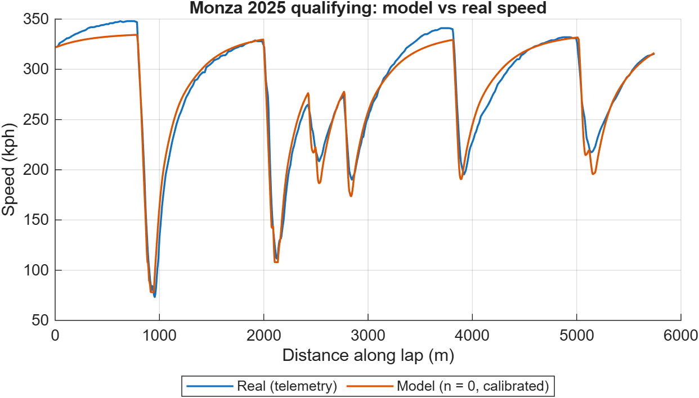

# Quasi-static lap-time simulator (MATLAB): load-sensitive grip

A quasi-static lap-time simulator built on real Monza 2025 qualifying telemetry. It started as a constant-grip point-mass model; the current version (V0) replaces a distance-based grip correction with a physically motivated **load-sensitive tyre model** and uses it to ask how much a downforce change is really worth.

[One-page summary (PDF)](LTS_V0_one_pager.pdf)

## Key results

| | |
|---|---|
| Simulated lap (constant grip, baseline) | 77.13 s |
| Real lap (2025 Monza qualifying, telemetry) | 78.63 s |
| Error | 1.9 % |
| Grip sensitivity | about 1.0 s per 5 % change in grip |
| Grip-use factor that matches the lap | 0.93 |

### Downforce sensitivity depends on tyre load sensitivity

Tyre grip is modelled as `mu = mu_ref * (Fz / Fz_ref)^(-n)`, where `Fz` includes static weight and aerodynamic load. One lap cannot identify the exponent `n`: speed-trace error and lap time have a flat valley in `n`. So `n` is reported as a range, and `mu_ref` is recalibrated to the same real lap for each value.

| n | mu_ref (calibrated) | +5 % Cl | -5 % Cl | +10 % Cl |
|---|---|---|---|---|
| 0.0 | 2.233 | -0.379 s | +0.375 s | -0.762 s |
| 0.1 | 2.337 | -0.320 s | +0.314 s | -0.639 s |
| 0.2 | 2.444 | -0.266 s | +0.269 s | -0.534 s |

The more load-sensitive the tyre, the less lap time a given downforce change buys. A real tyre test would be needed to narrow this down.

## Method

1. Real track curvature and speed are derived from telemetry (extracted with FastF1 in extract_telemetry.ipynb; raw data is not included here).
2. Corner speed from `m v^2 kappa = mu(v) (m g + downforce)`, solved iteratively because grip depends on speed through downforce.
3. Longitudinal limits: traction (with the friction circle) and power/drag for acceleration; combined-slip braking for deceleration.
4. Forward pass (acceleration-limited) and backward pass (braking-limited), then the minimum of both gives the speed profile.
5. Lap time by integrating distance over the average speed.
6. The load-sensitive tyre model feeds all three limit functions; with `n = 0` it reproduces the original constant-grip model exactly (regression check).

### Files

| File | Purpose |
|---|---|
| `LTS_V0.m` | Main script: baseline, calibration, identification grid, wing sweep, export |
| `run_lap.m` | One full lap for a given `mu_ref`, `n` and `Cl` |
| `tyre_mu.m` | Load-sensitive friction coefficient |
| `corner_speed.m`, `accel_max.m`, `decel_max.m` | Speed limits |
| `extract_telemetry.ipynb` | Downloads the lap with FastF1 and writes the CSV |
| `results/results_wing_sweep.csv` | Wing sweep for n = 0, 0.1, 0.2 |
| `figures/wing_sweep.png`, `figures/speed_trace.png` | Figures used in this README |

## How to run

- MATLAB R2020a or later (uses `exportgraphics`). As far as I know it needs no extra toolboxes; only base MATLAB functions are used.
- Run `extract_telemetry.ipynb` first (Python with `fastf1`, `numpy`, `matplotlib` and `pandas`). It creates `data/monza_2025Q_VER_fastest.csv`. The telemetry itself is not included in this repo.
- Open the LTS folder in MATLAB and run `LTS_V0.m` section by section. G3 calibrates `mu_ref`, G4 and G5 run the wing sweep, G6 and G7 write the figures.

## Limitations

- Quasi-static point-mass model with load averaged per axle (`Fz/4`); no lateral load transfer or per-wheel loads yet.
- One lap, one circuit; `n` is not identifiable from this data and is shown as a range.
- The 0.93 grip-use factor is an empirical fit to the lap, not a measured quantity.
- Aero, mass and power values are estimates, not team data.

## Future work

Lateral load transfer and per-wheel tyre loads, a transient bicycle model, driver styles, and more circuits.

## Data

Telemetry is fetched with [FastF1](https://github.com/theOehrly/Fast-F1) and is not redistributed. `extract_telemetry.ipynb` downloads the 2025 Monza qualifying fastest lap for VER and writes `data/monza_2025Q_VER_fastest.csv` (distance, position, speed, time, throttle, brake, gear). Only derived results are included in this repo.

## Author

Sris Kumar Sridhar, MSc Mechanical Engineering (Automotive & Motorsports), Politecnico di Milano.
Feedback on the load-sensitive tyre approach from Ian Wright is gratefully acknowledged.
